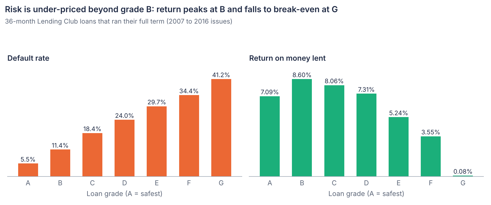
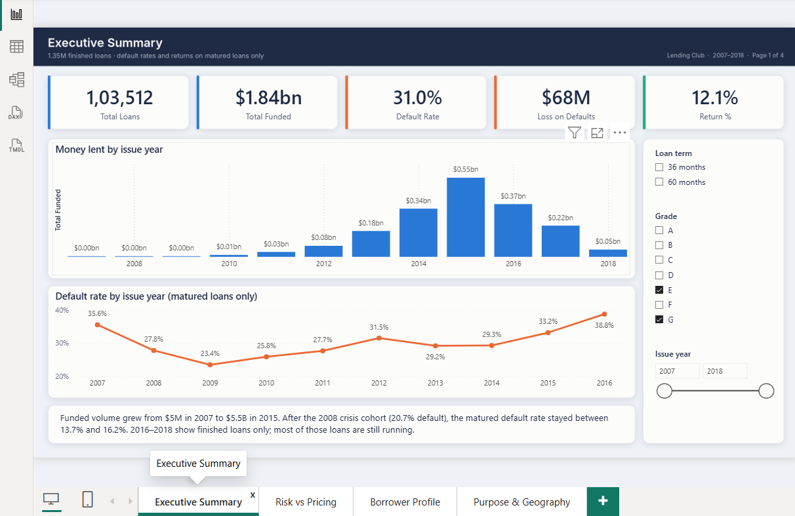
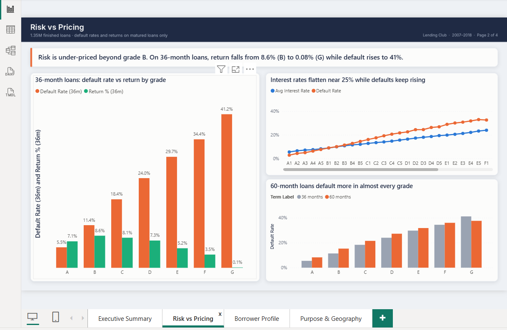
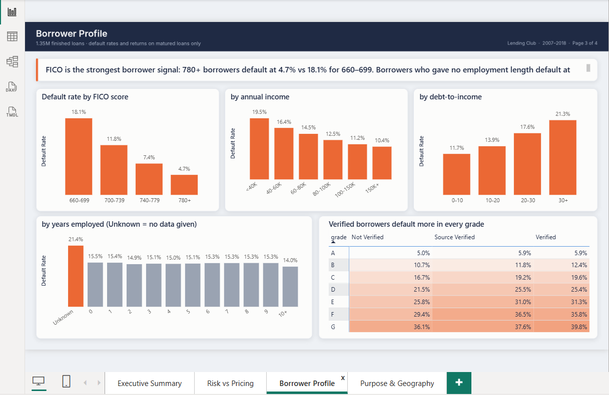
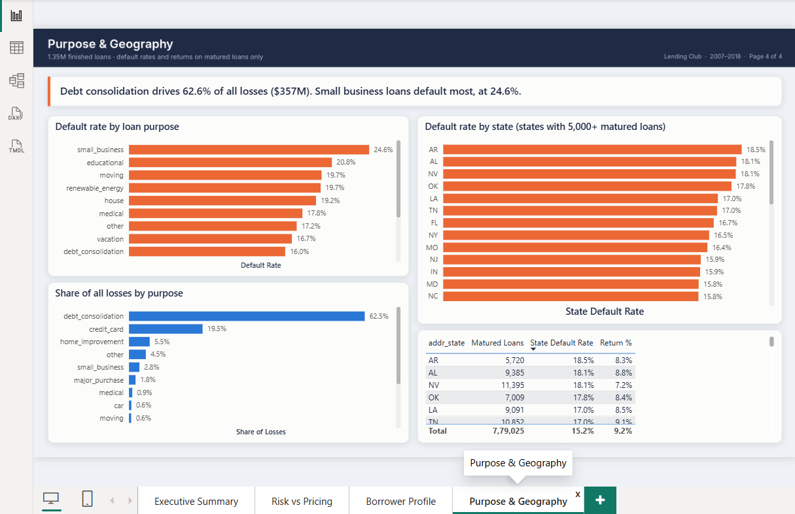

# Bank Loan Default & Profitability Analysis (Python + MySQL + Power BI)

An end-to-end analysis of 1.35 million finished Lending Club loans (2007 to 2018). The 2.26M-row raw file is cleaned in Python, loaded into MySQL, and analyzed with 12 SQL business questions. The results feed a 4-page Power BI dashboard and a set of lending recommendations.



## Key findings

Default rates and returns are measured on **matured loans only** (779,025 loans whose full term ended before the March 2019 data cut-off). See [Why matured loans only](#why-matured-loans-only).

| # | Finding | Evidence |
|---|---|---|
| 1 | **Risk is under-priced beyond grade B.** On 36-month loans, return peaks at grade B and falls to break-even at G. | Return 8.60% (B) vs 0.08% (G); G charges 25% interest but 41.2% default |
| 2 | **Debt consolidation is where the money is lost.** It is 57% of loans but 62.6% of all losses. | $356.8M of $570M lost; with credit card refinancing, 82% of losses |
| 3 | **FICO score is the strongest borrower signal.** | 780+ default at 4.7% vs 18.1% for 660 to 699 (3.9x) |
| 4 | **60-month loans default 1.8x as often**, and the gap holds within every grade A to F. | 25.4% vs 14.2%; grade A 8.3% vs 5.5% |
| 5 | **Missing data is a risk signal.** Borrowers who gave no employment length default at 21.4%. | 1.4x the 15.2% average; years employed 0 to 10 barely matter (14.0% to 15.5%) |
| 6 | **Verified borrowers default more**, in every grade. Lending Club verified the applications it already found risky. | 18.3% verified vs 11.8% not verified; grade C 19.6% vs 16.7% |
| 7 | **Income and debt load matter, geography much less.** | Income <$40K 19.5% vs $150K+ 10.4%; DTI 30+ 21.3% vs 0 to 10 11.7%; worst state (AR) only 3 points above average |

Portfolio: $10.30B lent and $11.24B received on matured loans, a 15.19% default rate, $0.57B lost on defaults and a +9.18% net return.

## Recommendations

1. **Reprice or cap grades E to G.** Their interest rates flatten near 25% while defaults keep rising, so they earn almost nothing. Raise rates, tighten approval, or limit their share of new lending.
2. **Tighten debt-consolidation underwriting.** It carries most of the losses, so small improvements in approval rules there have the biggest effect.
3. **Price 60-month loans higher than 36-month loans in the same grade**, since they default about 1.8x as often.
4. **Weight FICO and DTI more heavily in grading**, and treat a missing employment length as a risk flag rather than a neutral value.
5. **Review the verification process.** Verification currently marks risky applications without making them safer.

## Dashboard (Power BI)

| | |
|---|---|
|  |  |
|  |  |

1. **Executive Summary:** KPI cards, money lent by year, default rate by year, slicers for term, grade and year
2. **Risk vs Pricing:** default vs return by grade, interest rate vs default by sub-grade, 36 vs 60-month default
3. **Borrower Profile:** default rate by FICO, income, DTI and years employed; verification matrix by grade
4. **Purpose & Geography:** default rate and share of losses by purpose, default rate by state

## Tools

- **Python** (Pandas, NumPy) in Google Colab, for cleaning and feature engineering
- **MySQL** and MySQL Workbench, for storage and SQL analysis
- **SQL techniques:** views, CTEs, window functions (`RANK`, `LAG`, `SUM() OVER`), conditional aggregation with `CASE`
- **Power BI:** Power Query, DAX measures, custom theme, sort-by columns

## Dataset

Source: [Lending Club loan data on Kaggle](https://www.kaggle.com/datasets/wordsforthewise/lending-club) (`accepted_2007_to_2018Q4.csv`, 2.26M loans, 151 columns). The data files are too large for GitHub, so download them from Kaggle and run the notebook.

| File | Rows | Columns | Description |
|---|---|---|---|
| `accepted_2007_to_2018Q4.csv` | 2.26M | 151 | Raw data (1.55 GB) |
| `loans_clean.csv` | 1,348,059 | 36 | Finished loans only, cleaned and enriched; loaded into MySQL and Power BI |

## Approach

### 1. Cleaning (Python)
- Read 29 of 151 columns in 200K-row chunks to fit in memory
- Kept only finished loans (Fully Paid and Charged Off), since a Current loan's outcome is unknown
- Converted text to numbers: `" 36 months"` to 36, `"13.5%"` to 13.5, `"Dec-2015"` to a date, `"10+ years"` to 10
- Blanked impossible values (DTI below 0 or above 100, income of 0) instead of dropping the loans

### 2. Feature engineering (Python)
| New column | Logic |
|---|---|
| `is_default` | 1 if Charged Off, so its average is the default rate |
| `net_profit` | Total repaid minus amount funded |
| `is_matured` | 1 if the full term ended before March 2019 |
| `fico_avg` | Average of the FICO range |
| `income_band`, `dti_band`, `fico_band` | Grouped bands for comparisons |

### 3. Loading (MySQL)
A typed `loans` table with `DECIMAL` money columns, loaded with `LOAD DATA LOCAL INFILE` and `NULLIF` so blank cells become NULL instead of 0. See Part A of [`sql/bank_loan_analysis.sql`](sql/bank_loan_analysis.sql).

### 4. Analysis (SQL)
12 business questions: portfolio KPIs, grade pricing, term, purpose, borrower profile, employment, verification, geography, growth by year and sub-grade returns. See Part B of [`sql/bank_loan_analysis.sql`](sql/bank_loan_analysis.sql), with all results in [`FINDINGS.md`](FINDINGS.md).

### 5. Dashboard (Power BI)
13 DAX measures that follow the same matured-loans rule as the SQL, so the dashboard numbers match the queries exactly.

## Why matured loans only

The data was cut in March 2019. For loans issued in 2016 to 2018, the ones that already failed are finished, while most good loans are still running and were excluded. Including them makes risk look higher than it is: 19.98% default across all finished loans vs **15.19% on matured loans**. Comparing grades, years or segments fairly means using matured loans only.

A second check: comparing return across grades on all loans makes riskier grades look *more* profitable, because they hold more 60-month loans that earn 5 years of interest instead of 3. Holding the term fixed (36-month only) shows the real pattern in finding 1.

## Repository structure

```
bank-loan-default-analysis/
├── notebooks/
│   └── clean_loans.ipynb            # cleaning + feature engineering (Colab)
├── sql/
│   └── bank_loan_analysis.sql       # table + CSV load, then 12 business questions
├── powerbi/
│   └── bank_loan_dashboard.pbix     # the dashboard
├── images/                          # README chart and dashboard screenshots
├── FINDINGS.md                      # every query result
└── README.md
```

## How to run

1. Download `accepted_2007_to_2018Q4.csv` from Kaggle and run `notebooks/clean_loans.ipynb` to create `loans_clean.csv`.
2. In MySQL Workbench, open `sql/bank_loan_analysis.sql`, set the CSV path in Part A, and run it.
3. Open `powerbi/bank_loan_dashboard.pbix`, then go to Transform data → Edit parameters → `CsvPath`, set your path to `loans_clean.csv`, and refresh.
